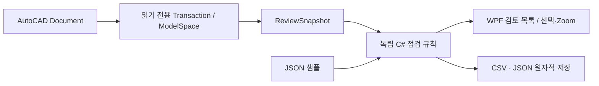

# CAD Productivity Palette

선택 객체 편집, 자주 쓰는 명령, 도면 점검과 보고서 인계를 한곳에 모은 AutoCAD 도킹 팔레트입니다. 반복 명령을 찾는 작업과 검토 대상 객체를 다시 찾는 과정을 줄이기 위해 만들었습니다.

C# · .NET 10 · WPF · AutoCAD .NET API

## 핵심 기능

| 영역 | 기능 |
|---|---|
| 선택 객체 | 객체 종류·주요 속성 확인, 종류에 맞는 편집 도구 |
| 명령 실행 | 6개 그룹의 Quick Tool 36개, 언어 독립 `_.COMMAND` 실행 |
| 사용 기록 | 완료한 명령의 최근·자주 사용 목록, 취소·실패 제외, 로컬 저장·초기화 |
| 모드 | 기본 도구 8개의 심플 모드 / 전체 도구·점검 모드, 설정 유지 |
| 도면 점검 | 열린 Polyline·직접 색상·빈 Text·단위 미지정, Layer 0 참고 정보 |
| 검토 이동 | 점검 대상 객체 선택과 Zoom |
| 인계 | Handle과 판정 근거를 담은 CSV·JSON 보고서 |

## 실행 환경과 빌드

기본 대상은 **Windows / AutoCAD 2027 / .NET 10 SDK**입니다. AutoCAD 설치 폴더의 API DLL을 참조하며 Autodesk DLL을 저장소에 배포하지 않습니다.

```powershell
dotnet build -c Release
```

설치 위치가 다르면:

```powershell
dotnet build -c Release '-p:AutoCADDir=D:\Autodesk\AutoCAD 2027'
```

AutoCAD에서 `NETLOAD`로 `bin/Release/net10.0-windows/CadProductivityPalette.dll`을 불러온 뒤 **`CADTOOLS`** 를 실행합니다. 보안 경고가 발생하면 빌드한 DLL 폴더를 AutoCAD 옵션의 **신뢰할 수 있는 위치**에 등록합니다. 전역 보안 로드를 끌 필요가 없습니다.

AutoCAD 2026용 빌드는 `-p:AutoCADVersion=2026`으로 .NET 8을 대상으로 합니다. 해당 버전의 SDK와 AutoCAD API가 필요합니다. 이번 변경의 실제 검증 대상은 2027입니다.

## 5분 사용 흐름

1. `CADTOOLS`로 팔레트를 열고 객체를 선택해 속성을 확인합니다.
2. 심플 모드에서 기본 명령을 실행하고 전체 모드로 전환해 36개 도구를 확인합니다.
3. 도면 점검의 `다시 점검`을 누릅니다.
4. 열린 Polyline 등의 `선택 + 줌`으로 해당 객체를 찾습니다.
5. 실제 설계 의도를 확인한 뒤 사용자가 직접 수정합니다.
6. `보고서 저장`으로 CSV 또는 JSON을 저장해 검토 내용을 전달합니다.

`CADREVIEWEXPORT`는 저장 대화상자를 열고, `CADREVIEWBATCH`는 명령행에서 저장 경로를 받습니다. 보고서는 도면을 자동 수정하지 않습니다. 기존 편집 도구와 Quick Tool은 사용자의 명령에 따라 도면을 변경합니다.

## 점검 기준

| ID | 대상 | 의미 |
|---|---|---|
| `OPEN_POLYLINE` | 닫히지 않은 2D Polyline | 의도한 열린 선인지 검토 |
| `DIRECT_COLOR` | ByLayer가 아닌 색상 | 직접 색상·ByBlock 설정 검토 |
| `EMPTY_TEXT` | 공백 Text / MText | 빈 주석 후보 검토 |
| `UNSPECIFIED_UNITS` | INSUNITS=0 | 도면 단위 확인 |
| `LAYER_ZERO` | Layer 0 객체 | 프로젝트 레이어 정책에 따른 참고 정보 |

ModelSpace의 직접 객체를 검사합니다. Block 내부·외부 참조·PaperSpace를 재귀 검사하지 않습니다. 점검은 프로젝트 예시 규칙이며 국가 CAD 납품 표준 적합 판정이 아닙니다. 열린 선이나 직접 색상도 설계 의도상 정상일 수 있어 자동 수정하지 않습니다.

후보 수는 **규칙별 적발 건수의 합계**입니다. 같은 객체가 여러 규칙에 포함될 수 있으며 도면 단위 문제도 1건으로 집계합니다.

## 실제 AutoCAD 엔진 검증

AutoCAD 2027 Core Console에서 **메인 플러그인 DLL을 NETLOAD**하고, 가상 객체 3개를 만든 후 `CADREVIEWBATCH`로 보고서를 생성했습니다.

| 입력 | 결과 |
|---|---|
| 열린 빨간 Polyline 1개 | 열린 Polyline 1건 + 직접 색상 1건 |
| ByLayer Line 1개 | 검토 후보 없음 |
| 공백 Text 1개 | 빈 Text 1건 |
| INSUNITS=0 | 단위 미지정 1건 |
| Layer 0 객체 3개 | 참고 3건 / 후보 합계에서 제외 |

**총 객체 3개 / 검토 후보 4건**을 실제 엔진에서 확인했습니다.

- [실제 AutoCAD 생성 JSON](examples/reports/autocad-engine-review.json)
- [실제 AutoCAD 생성 CSV](examples/reports/autocad-engine-review.csv)
- [실행 검증 기록](docs/verification.md)

```powershell
powershell -ExecutionPolicy Bypass -File scripts/verify-autocad.ps1
```

이 스크립트는 새 임시 도면만 만들며 기존 도면을 열지 않습니다. 해당 빌드 폴더를 일시적으로 신뢰 경로에 추가해 DLL을 로드하고 즉시 원래 경로로 복원합니다. GUI 팔레트의 도킹·대화상자 클릭 검증은 별도 수동 확인 범위입니다.

## AutoCAD 없이 규칙 실행

점검 규칙은 AutoCAD API와 분리되어 있습니다. .NET 10 SDK만 있으면 샘플 스냅샷을 분석할 수 있습니다.

```powershell
dotnet run --project tools/ReviewRunner -- --self-test
dotnet run --project tools/ReviewRunner -- samples/inspection-demo.json examples/reports/demo-review
```

**22개 검사 통과**: 규칙·Handle 중복·CSV 인용과 수식 보호·JSON 왕복, 명령 카탈로그·정규화, 사용 기록 저장·초기화·손상 복구, 모드 저장을 확인합니다. `demo-review.*`는 JSON 샘플을 분석한 결과이고 `autocad-engine-review.*`는 실제 AutoCAD 엔진 출력입니다.

전체 로컬 검증은 다음으로 실행합니다.

```powershell
powershell -ExecutionPolicy Bypass -File scripts/verify.ps1
```

[GitHub Actions 설정 템플릿](docs/ci/verify.yml)은 Autodesk 설치 없이 실행 가능한 22개 검사를 수행하도록 작성했습니다. 현재 연결된 토큰에는 `workflow` 권한이 없어 자동 실행 등록은 제외했습니다. 플러그인 Release 빌드는 로컬 AutoCAD 2027 API에서 **경고 0 / 오류 0**을 확인했습니다.

## 배포 묶음

```powershell
powershell -ExecutionPolicy Bypass -File scripts/package.ps1
```

`.artifacts/`에 AutoCAD 2027용 `.bundle` 폴더와 ZIP을 만듭니다. AutoCAD를 종료하고 bundle 폴더를 `%APPDATA%/Autodesk/ApplicationPlugins/`에 복사하면 명령 실행 시 로드할 수 있습니다. 설치된 AutoCAD의 신뢰 경로 정책을 따릅니다. SDK DLL은 묶음에 포함하지 않습니다.

## 구조



- [독립 점검 규칙·출력](Core/DrawingReview.cs)
- [실제 도면 스캐너](Services/DrawingStatusService.cs)
- [보고서 명령](Commands/ReviewCommands.cs)
- [WPF 바인딩과 명령](UI/ProductivityViewModel.cs)
- [명령 카탈로그](Services/ToolCatalog.cs)
- [엔진 없는 검증 러너](tools/ReviewRunner/Program.cs)

점검은 읽기 전용 트랜잭션으로 객체 정보를 추출하고 Handle을 유지합니다. UI의 ObjectId와 순수 규칙의 Handle을 매핑해 검토 위치로 이동합니다. CSV는 UTF-8 BOM·따옴표 인용·수식 시작 문자 보호를 적용하고, 임시 파일 작성 후 교체해 저장 중 실패로 인한 기존 파일 손상을 줄입니다.

## 적용 범위

개인 CAD 업무 지원 도구입니다. 실제 도면 품질을 보증하거나 설계 검토자의 판단을 대체하지 않습니다. 현재 동기식 ModelSpace 검사이므로 대형 도면의 응답 시간·메모리·실제 프로젝트 규칙은 별도로 검증해야 합니다. Autodesk 제품·API의 사용과 배포에는 해당 라이선스가 적용됩니다.
